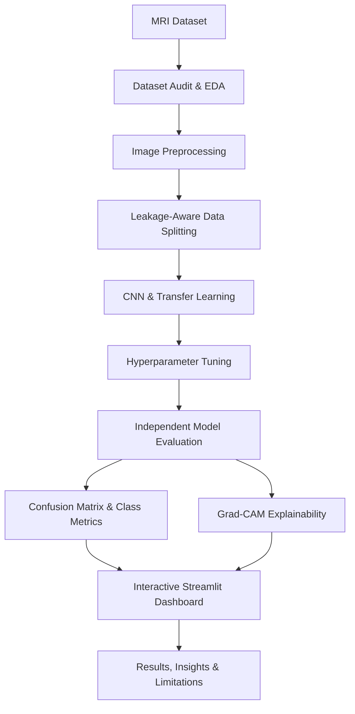

# 🧠 Brain Tumor MRI Image Classification
### Deep Learning • Medical Image Analytics • Explainable AI • Streamlit

Real-time 4-class brain-MRI classification — **glioma · meningioma · pituitary · no tumor** — with confidence analytics,
Grad-CAM explainability, a stability (TTA) check, live session analytics and a model-comparison dashboard.

**Model (from the notebook):** ResNet50V2 fine-tuned from ImageNet — 87.5 % test accuracy, macro-F1 0.864, ROC-AUC 0.976
on a leakage-free split (407 test images). Weakest class: meningioma (recall ≈ 65 %).

## Features
| Tab | What recruiters see |
|---|---|
| 🔬 Live Diagnosis | Upload (multi-file) / webcam / sample gallery → prediction, confidence gauge, class probabilities, margin, uncertainty, latency, TTA stability, triage message, Grad-CAM for any class, session log + CSV export |
| 📊 Model Performance | Leaderboard (macro-F1), accuracy-vs-latency trade-off, per-class precision/recall/F1, confusion matrix, training curves |
| 📖 About | Pipeline, dataset balance, honest limitations |


<p align="center">
  <strong>An end-to-end deep learning project for classifying brain MRI images into four categories, supported by model evaluation, data analysis, and explainable AI.</strong>
</p>

<p align="center">
  <a href="https://brain-tumor-mri-classification-abgwcmcbjt4dgfbbnbhh5y.streamlit.app/">
    🚀 <strong>LIVE INTERACTIVE DEMO</strong>
  </a>
  &nbsp; | &nbsp;
  <a href="https://github.com/SUMANSANGEET/Brain-Tumor-MRI-Classification">
    📂 GitHub Repository
  </a>
</p>

<p align="center">
  
  
  
  
  
  
</p>

---

## 📌 Project Overview

Brain Tumor MRI Image Classification is a deep learning project that explores automated classification of brain MRI images using convolutional neural networks and transfer-learning architectures.

The project combines image preprocessing, exploratory data analysis, model development, performance evaluation, and explainable AI in an interactive application designed to communicate machine learning results clearly.

The goal is not simply to produce a prediction. It is to investigate how models behave, compare classification performance, identify errors, and communicate results through useful visual analytics.

### 🎯 Project Objectives

- Classify MRI images into four target categories.
- Develop and evaluate deep learning image-classification models.
- Compare CNN architectures using consistent evaluation metrics.
- Analyze class-level performance and misclassification patterns.
- Investigate image characteristics and dataset quality.
- Explore Grad-CAM visual explanations for model predictions.
- Present model outputs through a user-friendly Streamlit application.
- Apply reproducible, leakage-aware machine learning practices.

## 🚀 Live Application

**Try the deployed application:**

👉 https://brain-tumor-mri-classification-abgwcmcbjt4dgfbbnbhh5y.streamlit.app/

The deployed application is the primary demonstration of the project. Available functionality depends on the current deployment and configured model artifacts.

## 🧩 Classification Categories

The project uses four target classes:

| Class | Description |
|---|---|
| `glioma` | MRI images labelled as glioma |
| `meningioma` | MRI images labelled as meningioma |
| `no_tumor` | MRI images labelled as no tumour |
| `pituitary` | MRI images labelled as pituitary tumour |

These labels represent the dataset's classification categories. Predictions are experimental model outputs, not confirmed medical diagnoses.

## 📊 Interactive Analytics & Visual Intelligence

The project is designed to support several complementary views of model behaviour and dataset characteristics.

### 1. Executive Model Overview

A high-level summary for reviewers, recruiters, and technical stakeholders.

Potential visual components:

- Dataset size and class distribution
- Training, validation, and test split summaries
- Selected model and evaluation metrics
- Architecture comparison
- Key findings and limitations

**Insight framework**

- **Observation:** Identify a pattern in the data or model results.
- **Evidence:** Support the observation with a measured metric or visualization.
- **Implication:** Explain what the finding means for model reliability or future development.

### 2. Model Performance Analytics

Evaluate models using more than overall accuracy.

Recommended visualizations:

- Confusion matrix heatmap
- Per-class precision, recall, and F1-score
- Macro and weighted F1-score
- Training versus validation accuracy
- Training versus validation loss
- Architecture comparison chart
- Misclassified-image analysis

**Why it matters:** Overall accuracy can hide weak performance on an individual class. Class-level recall and confusion-matrix analysis provide a more informative view of classification errors.

### 3. Explainable AI with Grad-CAM

Gradient-weighted Class Activation Mapping (Grad-CAM) can help visualize image regions that contribute to a model's selected class score.

Recommended presentation:

- Original MRI image
- Class activation heatmap
- Heatmap overlay
- Predicted class and class probabilities
- Examples of correct predictions and confident mistakes

**Analytical objective:** Investigate whether model attention appears consistent with meaningful image regions and identify potentially misleading prediction patterns.

Grad-CAM is a model-explanation technique, not proof that a prediction is clinically correct or that a highlighted region represents a tumour.

### 4. Dataset Intelligence & Image Quality

Explore image-level characteristics and data quality before interpreting model results.

Potential visualizations include:

- Class frequency and split distribution
- Brightness and contrast distributions
- Sharpness and entropy analysis
- Image feature correlations
- PCA and t-SNE projections
- Duplicate or related-scan checks

**Analytical objective:** Understand data variability, potential dataset bias, image-quality differences, and the risks of information leakage between data splits.

> **Note:** Include only the dashboard sections and plots that are implemented and working in the deployed application. Add screenshots from your actual app to demonstrate the final result.

## 🧠 Deep Learning Models

The project contains model artifacts and experiments associated with multiple architectures.

| Model / experiment | Purpose |
|---|---|
| Custom CNN | Baseline convolutional neural network |
| Tuned Custom CNN | Custom CNN after hyperparameter tuning |
| EfficientNetB0 | Transfer-learning image-classification experiment |
| MobileNetV2 | Lightweight transfer-learning experiment |
| ResNet50V2 | Residual-network baseline experiment |

The presence of an artifact does not necessarily mean that the architecture is the final selected model or is available in the deployed application.

### Model Evaluation Strategy

Models should be evaluated using a consistent test set and comparable preprocessing.

Recommended metrics:

- **Accuracy:** Overall proportion of correct predictions.
- **Precision:** Proportion of predicted class instances that are correct.
- **Recall:** Proportion of actual class instances correctly identified.
- **F1-score:** Harmonic mean of precision and recall.
- **Macro F1-score:** Equal-weighted F1-score across classes.
- **Confusion matrix:** Distribution of correct and incorrect classifications.

The final model should be selected using documented validation results, appropriate error analysis, and an independent test evaluation—not training accuracy alone.

## 🔬 Machine Learning Workflow



### Methodology

1. **Data inspection:** Review image files, target labels, split assignments, and image-level metadata.
2. **Preprocessing:** Apply architecture-compatible image resizing, normalization, and other required transformations.
3. **Leakage-aware splitting:** Where multiple files derive from the same original scan, group related images so that related samples do not cross evaluation boundaries.
4. **Model development:** Train and evaluate the selected CNN and transfer-learning architectures.
5. **Hyperparameter optimization:** Compare candidate configurations using validation-based selection.
6. **Evaluation:** Measure classification performance using class-level and aggregate metrics.
7. **Explainability:** Generate Grad-CAM visualizations for selected predictions when supported by the model architecture.
8. **Deployment:** Integrate the selected model, metadata, and inference preprocessing into the Streamlit application.

## 🛠️ Technology Stack

| Category | Technologies |
|---|---|
| Programming | Python |
| Deep learning | TensorFlow, Keras |
| Data manipulation | NumPy, Pandas |
| Machine learning | Scikit-learn |
| Visualization | Matplotlib, Seaborn, Plotly |
| Image processing | Pillow, OpenCV |
| Experimentation | Jupyter Notebook |
| Interactive application | Streamlit |
| Version control | Git, GitHub |
| Model artifacts | HDF5 (`.h5`), Keras (`.keras`), model metadata |

Use the exact package versions tested in the project environment when preparing the final deployment dependencies.

## 📁 Repository Structure

```text
Brain-Tumor-MRI-Classification/
│
├── app/
│   └── app.py
│
├── artifacts/
│   ├── models/
│   │   ├── best_model.h5
│   │   ├── best_model.keras
│   │   ├── model_meta.json
│   │   └── ...
│   └── reports/
│       ├── confusion_matrix.png
│       ├── classification_report.csv
│       └── ...
│
├── data/
│   └── README.md
│
├── notebooks/
│   └── Brain Tumour MRI Classification.ipynb
│
├── src/
│   ├── config.py
│   ├── setup_dataset.py
│   ├── audit_dataset.py
│   ├── utils.py
│   ├── train.py
│   └── evaluate.py
│
├── .gitattributes
├── .gitignore
├── README.md
└── requirements.txt
```

This is a recommended layout; retain your actual filenames and folders where they differ. Large model artifacts may be managed with Git LFS or external artifact storage. Raw datasets and virtual environments should not be committed unnecessarily.

## ⚙️ Installation & Local Setup

### Prerequisites

- Python version compatible with the project dependencies
- Git
- Access to the dataset
- Trained model artifacts if running inference without retraining

### 1. Clone the repository

```bash
git clone https://github.com/SUMANSANGEET/Brain-Tumor-MRI-Classification.git
cd Brain-Tumor-MRI-Classification
```

### 2. Create a virtual environment

**Windows CMD:**

```bat
py -3.11 -m venv .venv
.venv\Scripts\activate
```

### 3. Install dependencies

```bat
python -m pip install --upgrade pip
pip install -r requirements.txt
```

Ensure the dependency versions are compatible with the project's TensorFlow/Keras code and the selected model artifact.

### 4. Configure the dataset and model artifacts

Follow the dataset instructions and the model-loading instructions documented in the repository.

Confirm that the application can locate the selected model and its corresponding metadata. If model files are stored externally, configure the download mechanism and URL required by the application.

Do not publish credentials, access tokens, or private download URLs.

### 5. Launch the application

If the Streamlit entry point is `app/app.py`, run:

```bat
python -m streamlit run app\app.py
```

If your entry point is in the repository root instead, use the corresponding path, such as:

```bat
python -m streamlit run app.py
```

## 📈 Results & Key Findings

Populate this section with the final measured results from the independent test evaluation.

| Metric | Final measured result |
|---|---|
| Selected architecture | Add the evaluated model name |
| Test accuracy | Add measured value |
| Macro precision | Add measured value |
| Macro recall | Add measured value |
| Macro F1-score | Add measured value |
| Number of test images | Add actual test count |

Do not leave placeholder values in the published README. If a metric has not been calculated, omit that row until it is available.

### Recommended insight cards

**Class-level performance**

- Observation: Which class has the lowest recall?
- Evidence: Report its measured recall and number of test samples.
- Implication: Explain which classification errors deserve further investigation.

**Generalization**

- Observation: Is there a substantial gap between training and validation performance?
- Evidence: Compare the final training and validation curves.
- Implication: Investigate overfitting, dataset shift, or insufficient data diversity where relevant.

**Explainability**

- Observation: Are Grad-CAM overlays consistent across correct and incorrect predictions?
- Evidence: Review representative images from each class.
- Implication: Identify potential model shortcuts and limitations requiring further evaluation.

## 🔍 Data Leakage & Reliability

Medical-image classification requires careful evaluation design.

This project emphasizes the importance of:

- Separating training, validation, and test data.
- Grouping related images from the same source scan where identifiers are available.
- Preventing augmented copies or duplicate images from crossing split boundaries.
- Selecting models and hyperparameters without using the test set.
- Reporting class-level performance instead of relying only on accuracy.
- Recording preprocessing and class-label ordering consistently between training and inference.

These practices reduce common evaluation risks, but they do not by themselves establish clinical validity or guarantee generalization to other hospitals or populations.

## ⚠️ Limitations & Responsible Use

- This project is an educational and research-oriented machine learning demonstration.
- It is not a clinically validated diagnostic system.
- Predictions may be affected by image quality, class imbalance, dataset bias, and differences between training and real-world images.
- Grad-CAM visualizations do not establish causality or medical correctness.
- Performance on the project dataset may not generalize to external clinical settings.
- A qualified medical professional must interpret MRI findings and make diagnostic decisions.

**Do not use this application as a substitute for professional medical assessment or treatment decisions.**

## 👨‍💻 Skills Demonstrated

This project showcases practical experience with:

- Deep learning and convolutional neural networks
- Transfer learning and model experimentation
- Hyperparameter optimization
- Image preprocessing and exploratory data analysis
- Classification metrics and error analysis
- Data leakage prevention and validation design
- Explainable AI using Grad-CAM
- Interactive dashboard development
- Model artifact management
- Git, GitHub, and Streamlit deployment

## 🌐 Project Links

- **Live application:** https://brain-tumor-mri-classification-abgwcmcbjt4dgfbbnbhh5y.streamlit.app/
- **GitHub repository:** https://github.com/SUMANSANGEET/Brain-Tumor-MRI-Classification

## 👤 Author

**P Suman Sangeet**

PGDM — Big Data Analytics

Interested in Data Science, Machine Learning, Deep Learning, AI-powered analytics, and interactive data products.

---

<p align="center">
  <strong>From MRI data to model evaluation and explainable insights.</strong>
</p>

<p align="center">
  ⭐ If you find this project useful, consider starring the repository.
</p>
